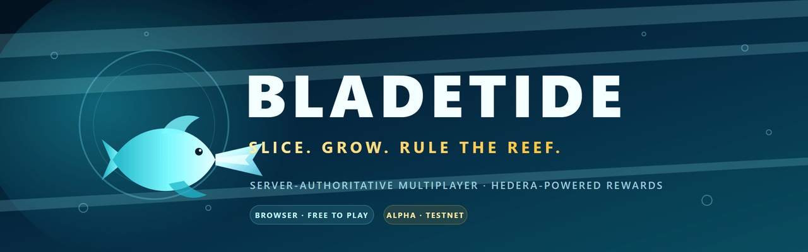
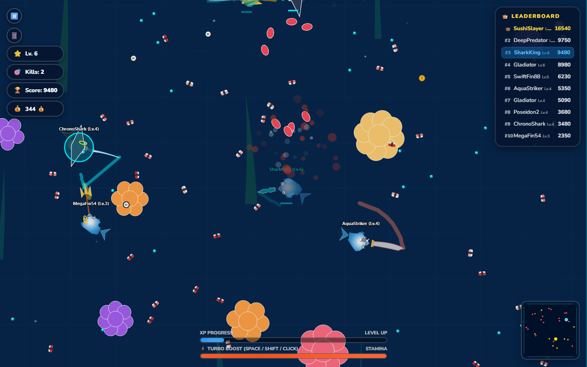
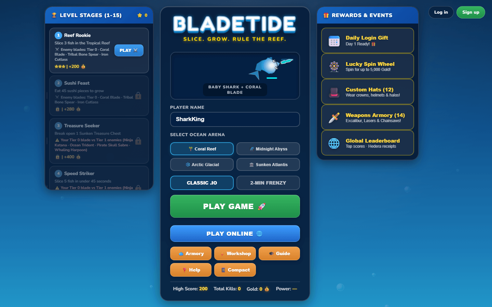
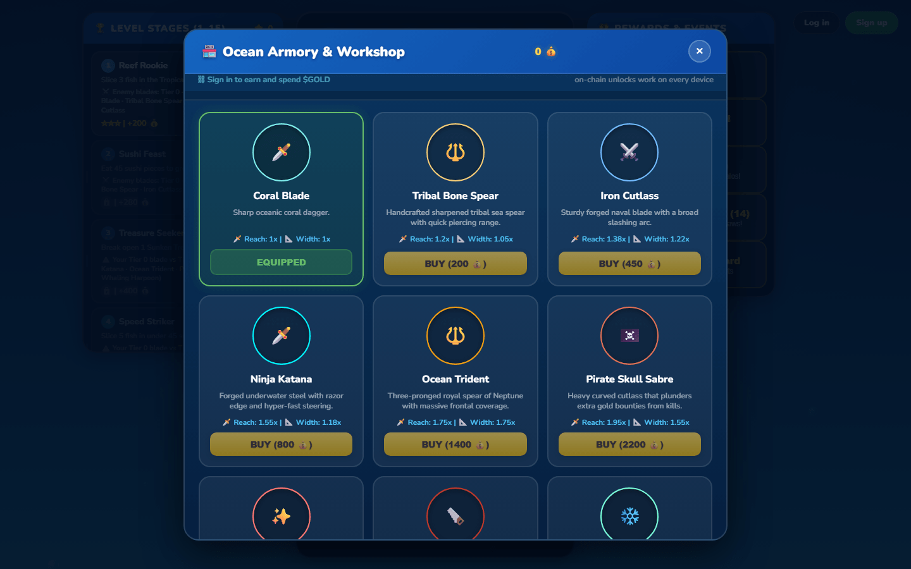
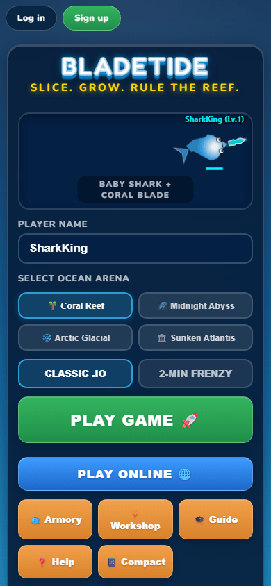
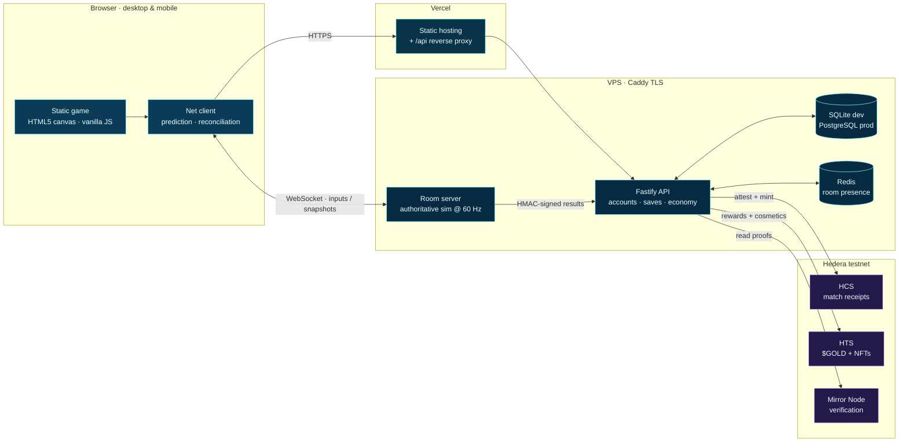

<div align="center">
  

  <h1>Bladetide</h1>

  <p><strong>Slice. Grow. Rule the reef.</strong></p>

  <p>
    A server-authoritative multiplayer <code>.io</code> arena for the browser —
    fast arcade combat, cross-device progression, and optional on-chain rewards on Hedera.
  </p>

  <p>
    <a href="https://fish-game-rouge.vercel.app">
      
    </a>
    <a href="LICENSE">
      
    </a>
    <a href="https://github.com/shripad-jyothinath/bladetide/actions/workflows/ci.yml">
      
    </a>
    
    
    
    
  </p>

  <p>
    <a href="#quick-start">Quick start</a> ·
    <a href="#features">Features</a> ·
    <a href="#architecture">Architecture</a> ·
    <a href="#hedera-integration">Hedera</a> ·
    <a href="#contributing">Contributing</a>
  </p>

  <br />

  <a href="docs/assets/screenshots/gameplay-clean.png">
    
  </a>
</div>

---

> **Project status: alpha.** The offline practice mode and the authoritative online arena are playable today. Hedera rewards run on **testnet only** — no real funds, no mainnet deployment, and APIs may change. See the [roadmap](#roadmap) for what is next.

## Features

- **Real-time, server-authoritative multiplayer.** A dedicated room server runs the simulation at 60 Hz and owns every position, kill and pickup. Clients send inputs only.
- **Responsive netcode.** Client-side prediction with snapshot reconciliation, interpolation for remote fish, delta-encoded world state, and a 20-second reconnect grace period.
- **A full arcade loop.** Slice rivals with a snout-mounted blade, eat sushi, smash chests, collect power-ups, and grow from bait to apex predator.
- **Deep progression.** 25 weapons, 24 fish species, 12 hats, 4 maps, 15 challenge stages and two match modes — plus a workshop upgrade tree.
- **Accounts that travel.** Email/password accounts, cross-device save sync, leaderboards, daily rewards and a once-per-day lucky wheel.
- **Optional Hedera layer.** Match receipts on HCS, a `$GOLD` HTS token, cosmetic NFTs with HIP-412 metadata, custodial wallets and wallet linking.
- **Guest-first by design.** No wallet or account is required to play; with no Hedera credentials the whole game runs in a clean offline mode.
- **Desktop and mobile.** Mouse, keyboard and drag-anywhere touch controls with a compact HUD for phones.
- **No bots online.** AI opponents exist only in offline practice mode; online arenas are humans only.

## Screenshots

<table>
  <tr>
    <td width="50%">
      <a href="docs/assets/screenshots/menu.png"></a>
      <br /><sub><b>Main menu</b> — stages, loadout, maps and daily rewards.</sub>
    </td>
    <td width="50%">
      <a href="docs/assets/screenshots/shop.png"></a>
      <br /><sub><b>Armory</b> — server-priced weapons with reach and width stats.</sub>
    </td>
  </tr>
  <tr>
    <td width="50%">
      <a href="docs/assets/screenshots/gameplay-clean.png"></a>
      <br /><sub><b>Arena</b> — live leaderboard, HUD, XP and boost stamina.</sub>
    </td>
    <td width="50%">
      <a href="docs/assets/screenshots/menu-mobile.png"></a>
      <br /><sub><b>Mobile</b> — responsive portrait layout with touch controls.</sub>
    </td>
  </tr>
</table>

## Quick start

### Requirements

| Requirement | Notes |
| --- | --- |
| **Node.js 22+** | Node 22 LTS or newer. Native `better-sqlite3` binaries are supported on Node 22/24. |
| **npm 10+** | Ships with Node 22+. |
| **Docker** *(optional)* | For PostgreSQL 16 and Redis 7 when working on the production database path. |
| **Hedera testnet account** *(optional)* | Enables match receipts, `$GOLD` and NFTs. Create one at [portal.hedera.com](https://portal.hedera.com). |

### Run the game locally

```bash
git clone https://github.com/shripad-jyothinath/bladetide.git
cd bladetide
npm install
npm run dev
```

Open **http://127.0.0.1:8080**. `npm run dev` serves the static game and the account API from one origin, so session cookies and save sync work without extra configuration.

Guests can play immediately. To test accounts, sign up from the top-right of the menu; the local SQLite database lives at `apps/api/data/bladetide.db`.

### Run the online arena

Start the authoritative room server in a second terminal:

```bash
npm run room:dev          # ws://127.0.0.1:8787 · health: http://127.0.0.1:8787/healthz
npm run dev               # website + API on http://127.0.0.1:8080
```

Open the site in **two tabs**, choose a name and press **PLAY ONLINE**. To point a client at another arena, use `?room=ws://host:port` or set `window.BLADETIDE_ROOM_URL`.

> **Controls:** mouse or `WASD`/arrow keys to steer · `Space`/`Shift`/left-click to boost · touch-drag on mobile. The blade is mounted on your snout — hit from the side or behind.

### Run the headless simulation

```bash
npm run game-core:sim     # deterministic 5-minute bot match, prints a summary
npm run game-core:test    # determinism, invariants and progression tests
```

The harness loads the real game scripts in a Node `vm` with DOM stubs and a seeded RNG, so a complete match runs without a browser. It is the foundation for the room server and for balance testing.

## Architecture



| Component | Responsibility |
| --- | --- |
| `apps/web` | The game client: canvas renderer, input, shop UI, 3D previews and the WebSocket net client. |
| `apps/api` | Fastify + TypeScript API: accounts, sessions, save sync, match intake, `$GOLD` ledger, leaderboards and Hedera services. |
| `apps/room-server` | Authoritative arena: owns the simulation, validates inputs, runs tick/food/chest deltas and posts results. |
| `packages/game-core` | Headless deterministic simulation harness shared by the room server, tests and economy tooling. |
| `deploy` | Caddy, systemd and VPS deployment runbook. |

### Netcode in one paragraph

The room server runs a fixed-step simulation and broadcasts snapshots. The browser predicts its own fish locally, reconciles against the authoritative snapshot with smoothing, and interpolates remote fish slightly behind the server clock. Food and chests are delta-encoded around each player's area of interest. The server validates movement, sequence numbers, payload size, message rate, cosmetics and upgrade caps — clients cannot set positions or rewards.

More detail: [`docs/MULTIPLAYER_PLAN.md`](docs/MULTIPLAYER_PLAN.md) · [`docs/adr/0001-headless-game-core.md`](docs/adr/0001-headless-game-core.md) · [`apps/room-server/README.md`](apps/room-server/README.md).

## Tech stack

| Layer | Technology |
| --- | --- |
| Game client | Vanilla JavaScript, HTML5 Canvas, Web Audio, Three.js previews (vendored, BSD/MIT) |
| API | Node.js, TypeScript, Fastify, `@fastify/cookie`, `@fastify/cors`, `@fastify/static` |
| Realtime | `ws` WebSocket server, fixed 60 Hz simulation, JSON protocol |
| Data | SQLite via `better-sqlite3` for local development; PostgreSQL 16 + Redis 7 as the production path |
| Chain | Hedera testnet via `@hiero-ledger/sdk`: HCS, HTS fungible tokens, HTS NFTs, Mirror Node |
| Tooling | npm workspaces, `tsx`, Node test runner, TypeScript `tsc` |

## Configuration

Copy the example environment file before enabling the optional integrations:

```bash
cp apps/api/.env.example apps/api/.env
```

The game is fully playable with no environment variables. The most useful settings are:

| Variable | Default | Purpose |
| --- | --- | --- |
| `HOST` / `PORT` | `127.0.0.1` / `8080` | API and static website bind address. |
| `BLADETIDE_DB_PATH` | `apps/api/data/bladetide.db` | Local SQLite database. `FISHIO_DB_PATH` is still accepted as a legacy alias. |
| `DATABASE_URL` / `REDIS_URL` | empty | PostgreSQL and Redis connection strings for the production data path. |
| `WEB_ORIGIN` | empty | Comma-separated allowed browser origins for cross-site cookies. |
| `INTERNAL_HMAC_SECRET` | dev placeholder | Shared secret used to sign room-server match results. Set a long random value in production. |
| `HEDERA_OPERATOR_ID` / `HEDERA_OPERATOR_KEY` | empty | Enable the Hedera testnet integration. |
| `WALLET_ENCRYPTION_KEY` | built-in dev key | Encrypts custodial wallet keys at rest. **Set a strong value before any real deployment.** |
| `HEDERA_AUTO_WALLETS` | `true` | Create an operator-funded custodial wallet for every account. |
| `PUBLIC_BASE_URL` | `http://127.0.0.1:8080` | Base URL used in NFT metadata. |

See [`apps/api/.env.example`](apps/api/.env.example), [`apps/api/.env.production.example`](apps/api/.env.production.example) and [`apps/room-server/.env.example`](apps/room-server/.env.example) for the full list.

## Hedera integration

Hedera is **optional and testnet-only**. With no credentials the API still records matches locally and the UI clearly reports that on-chain features are offline.

| Feature | Hedera service |
| --- | --- |
| Verifiable match receipts linked from the game-over screen | HCS topic |
| `$GOLD` rewards, deposits and withdrawals | HTS fungible token |
| Cosmetic NFTs with HIP-412 metadata and per-serial art | HTS NFT collection |
| Wallet linking by proof-of-ownership transfer | Mirror Node verification |
| Custodial wallets for every account | Operator-funded accounts, AES-256-GCM at rest |

Enable it:

```bash
# 1. Put testnet operator credentials in apps/api/.env
# 2. Create the HCS topic, $GOLD token and NFT collection
npm run hedera:setup -- --write-env

# 3. Restart the API
npm run dev
```

The setup command is idempotent; it reuses resources already stored in the database. A funded throwaway account and an end-to-end token/NFT proof are available with `--demo-account`. Everything is reversible: remove the Hedera ID lines from `.env` to return to offline mode.

> **Testnet only.** Never use mainnet keys or real funds with this repository in its current state. See [`SECURITY.md`](SECURITY.md) for the threat model and reporting process.

Deeper documentation: [`docs/HEDERA_PLAN.md`](docs/HEDERA_PLAN.md) · [`docs/DATABASE_PLAN.md`](docs/DATABASE_PLAN.md).

## Testing

```bash
npm run game-core:test    # headless determinism, balance and progression invariants
npm run room:test         # protocol, prediction, reconnect, flood protection, live two-client game
npm run api:test          # auth, sessions, saves, ledger, shop, tickets, signed match intake
npm run typecheck         # API + room-server TypeScript
```

The test suite runs offline. It uses temporary SQLite databases and mocked or disabled Hedera credentials, so no network access or funds are required.

## Project structure

```text
.
├── apps/
│   ├── web/              # Static game client (canvas, UI, shop, net client)
│   ├── api/              # Fastify API: accounts, saves, economy, Hedera
│   └── room-server/      # Authoritative WebSocket arena
├── packages/
│   └── game-core/        # Headless deterministic simulation harness
├── docs/
│   ├── assets/           # Brand, screenshots and diagrams
│   ├── adr/              # Architecture decision records
│   ├── ARCHITECTURE.md   # Deeper system design
│   └── DEVELOPMENT.md    # Maintainer and contributor notes
├── scripts/              # Static web server and small developer helpers
├── deploy/               # VPS runbook, Caddy, systemd
├── archive/              # Old prototype (not maintained)
├── docker-compose.yml    # PostgreSQL 16 + Redis 7 for local development
└── vercel.json           # Static web deployment
```

## Roadmap

- [x] Deterministic headless game simulation
- [x] Server-authoritative multiplayer arena (prediction, reconciliation, reconnect)
- [x] Accounts, cross-device saves and leaderboards
- [x] `$GOLD` ledger, shop, daily rewards and stage rewards
- [x] Hedera HCS receipts, HTS `$GOLD`, NFT cosmetics and custodial wallets
- [ ] M2: binary protocol and higher player counts
- [ ] Matchmaking and multi-region room director
- [ ] Mobile polish and performance pass
- [ ] WalletConnect signing for external wallets
- [ ] Marketplace and mainnet readiness

The detailed plans live in [`docs/MULTIPLAYER_PLAN.md`](docs/MULTIPLAYER_PLAN.md), [`docs/DATABASE_PLAN.md`](docs/DATABASE_PLAN.md) and [`docs/HEDERA_PLAN.md`](docs/HEDERA_PLAN.md).

## Contributing

Contributions are welcome. Please read [`CONTRIBUTING.md`](CONTRIBUTING.md) for the development setup, coding conventions and pull-request checklist, and [`CODE_OF_CONDUCT.md`](CODE_OF_CONDUCT.md) for community expectations.

Good first issues include:

- balance and feel improvements in offline practice;
- mobile layout and accessibility fixes;
- additional deterministic sim tests;
- documentation and deployment improvements.

For security issues, **do not open a public issue** — follow [`SECURITY.md`](SECURITY.md).

## License

Released under the [MIT License](LICENSE). Third-party components retain their own licenses; Three.js is vendored under its BSD/MIT terms.

## Acknowledgements

- [Hedera](https://hedera.com) and the [Hiero](https://hiero.org) SDK maintainers.
- [Fastify](https://fastify.dev), [ws](https://github.com/websockets/ws), [better-sqlite3](https://github.com/WiseLibs/better-sqlite3).
- [Three.js](https://threejs.org) for the procedural item previews.
- The browser `.io` games that inspired the genre.
