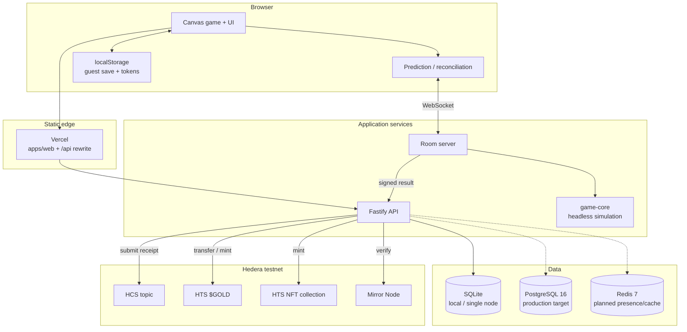
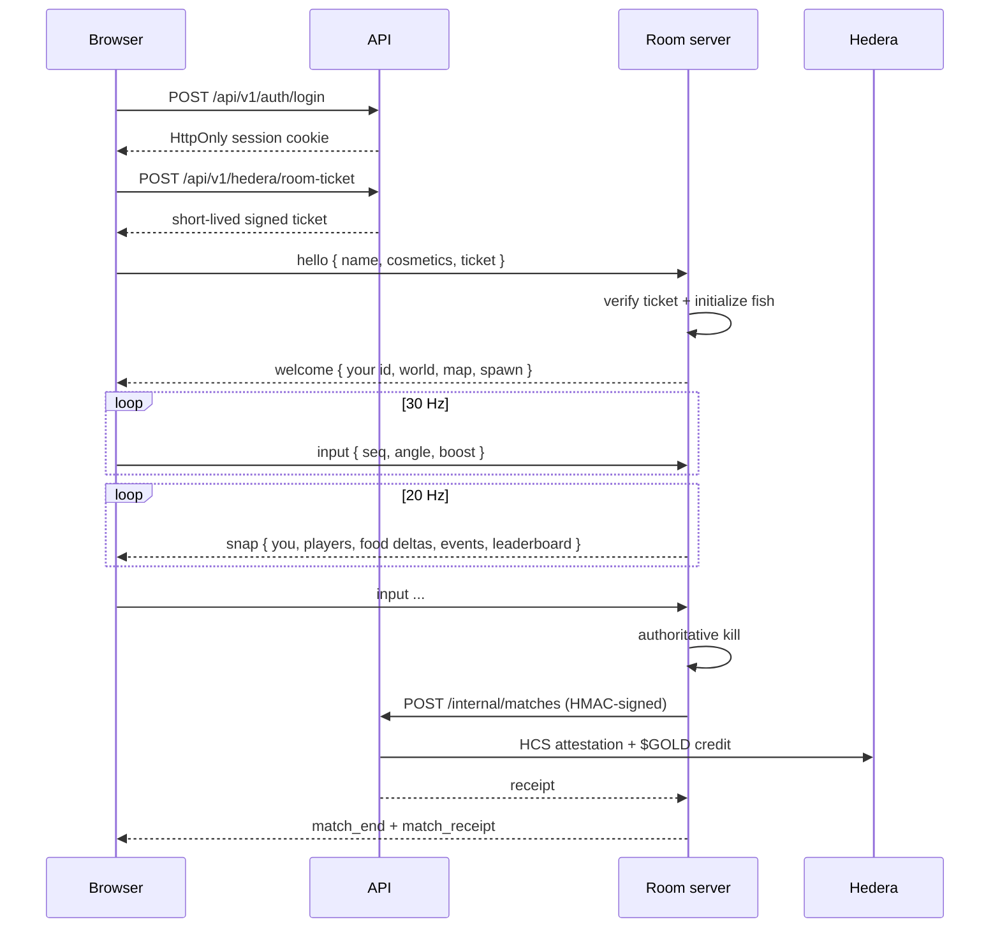

# Architecture

This document describes how Bladetide is put together today, which parts are authoritative, and where the boundaries are. It is deliberately honest about the alpha-stage gaps.

## Goals and constraints

- **Instant play.** A guest can load the static client and start a match without an account, wallet or backend.
- **Server authority online.** Positions, kills, pickups and match rewards are decided by the room server, never by the client.
- **One simulation.** The browser and the room server run the same game code. The headless harness loads the real scripts, which keeps balance and collision behavior from drifting.
- **Optional chain.** With no Hedera credentials the game runs offline. With credentials, match receipts and rewards become verifiable on testnet.
- **Boring infrastructure.** A single Fastify process can serve the site and API in development; static hosting and a small VPS are enough for the alpha.

## System context

The solid paths are implemented. Dashed paths are the intended production direction and are not required to run the alpha.

## Components

### `apps/web` — game client

- Vanilla JavaScript and HTML5 Canvas. No client build step; the API serves the directory or Vercel serves it statically.
- Owns input, rendering, audio, the menu/shop UI, guest saves and the visual polish (particles, 3D item previews).
- `src/net.js` implements the online client: 30 Hz inputs, local prediction, snapshot reconciliation, interpolation, reconnect tokens and leaderboard updates.
- All user-visible state is derived from the server snapshot while online. The client cannot award itself `$GOLD` in the arena.

### `apps/api` — Fastify API and website host

- Serves `apps/web` in local development, so cookies are first-party.
- Auth: scrypt password hashes, hashed session tokens, HttpOnly SameSite cookies and sliding 30-day sessions.
- Save sync: per-account save blobs with a last-write-wins guard that refuses to overwrite real progress with a default save from a new device.
- Economy: an append-only `gold_ledger` with atomic debits/credits, server-side prices, one-claim-per-period rewards and a match cooldown.
- Online intake: verifies an HMAC over the raw request body and records the result through the same reward pipeline as offline play.
- Hedera services: HCS receipts, HTS `$GOLD`, NFT minting, custodial wallets, wallet linking, Mirror Node reads and leaderboards.

### `apps/room-server` — authoritative arena

- One process hosts one room (a 4000×4000 map) with a configurable human-player cap. Bots never spawn online.
- Runs the headless game at a fixed 60 Hz and broadcasts snapshots at 20 Hz.
- Validates every client message: finite angles, monotonic sequence numbers, catalog IDs, upgrade caps, payload size and message rate.
- Keeps a disconnected player's fish during a 20-second grace period and lets the client reclaim it with a session token.
- On death, posts the server-authored result to `POST /internal/matches` with an HMAC signature and relays the receipt to the client.

### `packages/game-core` — deterministic simulation

- Loads the real browser scripts in a Node `vm` with DOM, canvas, audio, storage and timer stubs.
- Replaces `Math.random` with a seeded generator and provides virtual timers and a virtual clock.
- Exposes `loadGame`, `runMatch`, `stateHash` and the catalog to the room server, tests, economy tooling and the balance CLI.
- The same seed and inputs produce the same world hash, which makes regression tests and replay-based investigations possible.

See [ADR 0001](adr/0001-headless-game-core.md) for the decision and trade-offs.

## Online match flow

### Protocol summary

JSON over WebSocket in M1. Binary framing is planned for M2.

| Direction | Message | Purpose |
| --- | --- | --- |
| Client → server | `hello` | Name, cosmetics, upgrade levels, viewport, optional reconnect token and room ticket. |
| Client → server | `input` | Angle, boost flag and monotonic sequence number at ~30 Hz. |
| Client → server | `respawn`, `ping`, `leave` | Lifecycle and latency. |
| Server → client | `welcome` / `spawn` | Full initial state and your fish. |
| Server → client | `snap` | Authoritative snapshot: your fish, other players, interest-managed food/chests/power-ups, events, periodic leaderboard. |
| Server → client | `match_end` | Death result; followed by `match_receipt` when the API has attested the match. |
| Server → client | `pong`, `bye` | Latency and shutdown. |

## Trust boundaries

| Boundary | Rule |
| --- | --- |
| Browser → API | Treat all bodies as untrusted. Validate types, ranges and ownership server-side. |
| Browser → room server | The server owns the simulation. Clients send only angle/boost inputs; positions are never accepted. |
| Room server → API | The intake endpoint requires an HMAC over the exact raw bytes. The content type is isolated so JSON re-serialization cannot change the signed body. |
| API → Hedera | Operator credentials stay on the server. Wallet private keys are encrypted at rest with AES-256-GCM and never returned without a password check. |
| Client storage | Guest saves and room tokens are local conveniences, not authority. An account save is reconciled with the server copy. |

### Legacy identifiers

The project was previously named Fish.IO. A small number of `fishio` identifiers are intentionally retained so an upgrade does not silently break stored data:

- the SQLite database fallback (`apps/api/data/fishio.db` when no new database exists);
- the old session cookie (`fishio_session`) is still accepted and replaced on renewal;
- local save, guide, compact-UI and room-token keys are read once and migrated;
- the old HMAC content type and signature header are accepted alongside the new ones;
- the wallet-encryption salt and dev fallback key are kept as legacy keys so existing wallets remain decryptable.

New data always uses the `bladetide` names.

## Data model

The local SQLite schema and the PostgreSQL schema share the same core tables:

| Table | Purpose |
| --- | --- |
| `users`, `sessions` | Accounts and hashed session tokens. |
| `saves` | Last-synced account save blob and update timestamp. |
| `matches` | Match results, score, kills, level, gold and receipt metadata. |
| `gold_ledger` | Append-only `$GOLD` ledger (rewards, purchases, deposits, withdrawals, refunds). |
| `player_upgrades` | Server-owned workshop levels. |
| `reward_claims` | One-per-period daily, wheel and stage claims. |
| `entitlements` | Server-side ownership of shop items. |
| `nft_items` | Minted NFT serials and edition reservations. |
| `wallet_links`, `custodied_wallets`, `auth_nonces` | Wallet linking, encrypted custodial keys and proof nonces. |
| `hedera_resources` | Auto-created HCS topic, token and NFT collection IDs. |

The API currently uses SQLite for local and single-node deployments. The PostgreSQL/Redis schema and migration path are described in [`DATABASE_PLAN.md`](DATABASE_PLAN.md); the production adapters are not yet wired.

## Economy design

- **One currency for signed-in players:** `$GOLD`, tracked in the append-only ledger. Guests keep a separate practice balance that can never convert.
- **Rewards are uncapped and level-scaled:** `score/100 + kills×(5+level/3) + (level−1)×8 + chests×4`, with a frenzy multiplier.
- **Prices are tier-based:** T0 10–25, T1 100–250, T2 1k–2.5k, T3 10k–60k, T4 200k–1M. Hats remain cosmetic; workshop upgrades are separately priced.
- **Atomicity:** purchases, upgrades, withdrawals and claims use transactions or uniqueness constraints so a double-spend or replay cannot commit.
- **Server authority:** prices, rewards and ownership are computed on the server; the client renders what it is told.

## Deployment

| Piece | Where | Notes |
| --- | --- | --- |
| Static client | Vercel | `vercel.json` serves `apps/web` with clean URLs and `/api` rewrites. |
| API | VPS behind Caddy | Fastify on `127.0.0.1:18080`, TLS terminated by Caddy. |
| Room server | VPS behind Caddy | WebSocket on `127.0.0.1:18787`, same host or a dedicated room host. |
| Data | SQLite on the API host | Postgres/Redis are the intended production path. |
| Chain | Hedera testnet | Operator keys and auto-created resources live in `apps/api/.env`. |

The full runbook, including systemd units and Caddy snippets, is in [`../deploy/README.md`](../deploy/README.md).

## Failure modes and graceful degradation

- **No API:** the static client still runs guest practice; account features show a clear error.
- **No room server:** offline practice still works; **PLAY ONLINE** reports that the arena is unreachable.
- **No Hedera credentials:** matches are recorded locally, the UI reports `Hedera offline`, and no chain calls are attempted.
- **WebGL unavailable:** item previews fall back to 2D/emoji icons.
- **Disconnect during a match:** the room keeps the fish for 20 seconds; the client reconnects with its session token, otherwise the player is removed.
- **Stale client save:** the save sync refuses to overwrite a non-empty account save with a fresh default save.

## Next architecture work

- M2: binary protocol, more aggressive interest management and a load-tested player cap.
- M3: room director/matchmaking, multiple rooms per host, presence in Redis.
- PostgreSQL adapter and migrations; move the single-node SQLite path to a development-only role.
- WalletConnect signing for external wallets (today external wallets can link but cannot spend `$GOLD`).
- Mainnet readiness work: key management, rate limits, observability, abuse controls and a security review.
